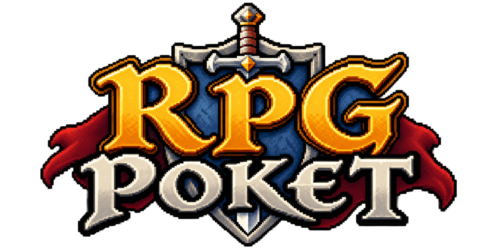
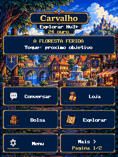
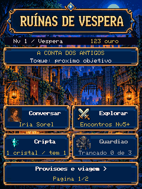
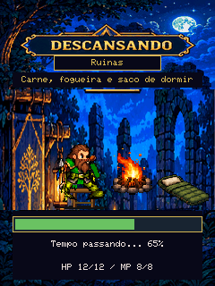
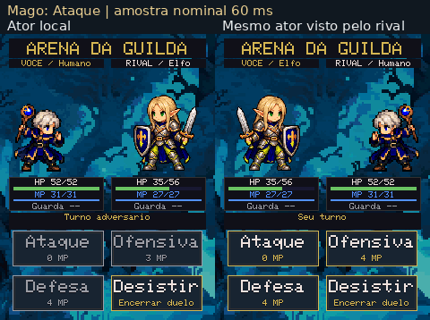
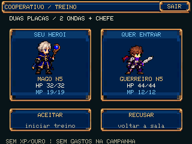
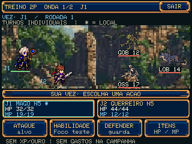
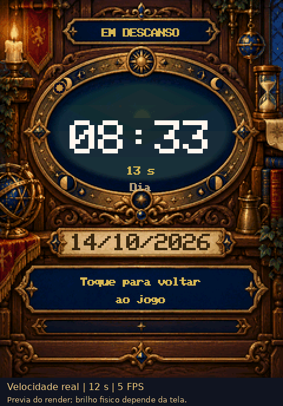

  

<h1 align="center">RPG POKET 2.0</h1>

<strong>De Carvalho às Ruínas de Vespera. Uma aventura na palma da mão.</strong>

Fantasia medieval em português · Pixel art inspirada nos 16 bits · ESP32-S3 · Tela de toque

  <a href="https://github.com/Oflodorporto/RPG-POKET-2/releases/tag/v2026.10.15-coopdiag77"><strong>Baixar a versão atual</strong></a> ·
  <a href="docs/GUIA_RAPIDO.md">Instalar e jogar</a> ·
  <a href="#um-pequeno-mundo-para-explorar">Ver o jogo</a> ·
  <a href="#documentação">Documentação</a>

Crie seu aventureiro, converse com os habitantes de Aeldra, atravesse estradas, explore ruínas e enfrente combates por turnos. Escolha uma classe, personalize sua aparência e acompanhe uma campanha com diário, cartas, personagens e progressão até o nível 20.

**Versão publicada:** 7.7 · Treino cooperativo: sinal e diagnóstico · `2026.10.15-coopdiag77` · build `2026101502`.
Qualificação de software, publicação e downloads públicos verificados no SHA exato. **A validação física desta versão, incluindo rádio entre duas placas, ainda está pendente.** [Estado completo e limites](docs/ESTADO_ATUAL.md).

## As Cinzas da Primeira Aurora

Em Aeldra, um sino toca numa torre vazia, a cinza adoece as raízes e nomes desaparecem das lembranças. Você chega a Carvalho quase sem ouro, em busca de abrigo e trabalho. Uma carta da Guilda conduz seus passos às ruínas de Véspera e ao mistério dos quatro faróis que protegem o reino. Sua história nasce das pessoas que você decide ajudar.

### Pelas estradas de Aeldra

O mapa atual percorre Aeldra, no oeste de Valdária, entre o mar e as montanhas. As estradas ligam quatro destinos:

- **Carvalho:** vila junto ao bosque, onde Nara oferece acolhimento e a jornada começa.
- **Ruínas de Véspera:** cidade abandonada, com expedições, mortos inquietos e a Cripta do Arconte.
- **Mares:** porto de mercadores e construtores navais, ameaçado por desaparecimentos e cargas suspeitas.
- **Aurora:** cidade da Coroa, dos arquivos e das forjas, onde antigos juramentos estão em disputa.

## Um pequeno mundo para explorar

  
  
  

<strong>Carvalho · Ruínas de Vespera · Acampamento</strong>

As imagens e animações desta página são **capturas do renderer do jogo em testes no computador (host)**. Não são fotos da placa, vídeo de hardware ou medições de FPS. O logo é uma arte do projeto. [Origem dos arquivos e hashes](docs/MIDIA_README.md).

### Escolha seu caminho

- **Um herói seu.** Quatro raças, quatro classes: Mago, Cavaleiro/Paladino, Guerreiro e Bárbaro. Cores, atributos, equipamentos e poderes acompanham a jornada.
- **Uma campanha para descobrir.** Uma jornada por Carvalho, Mares e Aurora, com conversas, objetivos, cartas, diário e uma ilha opcional.
- **Exploração e decisões.** Viagens por dias, provisões, encontros, baús, trancas e D20. A Cripta tem visão em primeira pessoa; novas entradas na Cripta das Ruínas usam geração procedural.
- **Combate por turnos.** Ataques, defesa, magias e poderes de classe, com HP/MP, intenção do inimigo, recompensas e bestiário.
- **Pausas que fazem parte da aventura.** Fadiga, refeições, acampamento personalizado e um relógio medieval que acompanha a hora local.
- **Comércio em lote.** Escolha quantas unidades comprar ou vender e confira o total antes de confirmar. A quantidade respeita o ouro e o inventário; rações agora cabem até **10**, com os demais limites e preços preservados.
- **Três jornadas salvas.** Três slots em NVS. As transições relevantes do jogo são gravadas automaticamente; se houver falha, a tela oferece **Tentar salvar**.

## Duelo na Arena da Guilda

  

Duas perspectivas da mesma partida, com os dois aventureiros completos, HP/MP, guarda, custos de mana e animações das ações confirmadas. A versão atual também permite desistir durante o turno do adversário.

**O protocolo PvP permanece v5, de 52 bytes, como em `pvp77`, e é incompatível com o v4 anterior.** Se a tela indicar protocolo incompatível, atualize as placas que ainda usam v4. A animação acima usa dois participantes simulados no host; a validação física completa desta versão, incluindo ESP-NOW/RF entre as placas, está pendente.

Se a comunicação cair **depois do início**, sem resultado confirmado, o duelo termina em **NAO CONFIRMADO**, sem prêmio e com a entrada já consumida. Antes do início, permanece a devolução integral. Uma vitória ainda não gravada pode ser perdida ao desligar. [Regras de interrupção e evidências](docs/ESTADO_ATUAL.md).

## Treino cooperativo experimental

  
  

<strong>Aceite do parceiro · Primeira onda · Capturas do renderer host</strong>

Na Guilda, abra **Coop treino**. Uma placa cria a sala, a outra escolhe a sala, e o anfitrião confere e aceita o parceiro. São **dois jogadores, duas ondas e um chefe**, em paisagem; ao sair, a Guilda volta ao retrato.

O encontro usa **cópias dos personagens somente em RAM**. Não concede XP, ouro ou recompensas, não avança missões, não consome poções da campanha e não altera seus saves nem o RNG da campanha. Ataque e escolha o alvo, use **Foco teste** (habilidade experimental de 2 MP), defenda ou use poções da cópia RAM. O treino não inclui o conjunto completo de poderes de classe nem coop com progressão de campanha.

**Sinal e diagnóstico coopdiag77:** indicador de intensidade recebida (RSSI), idade da amostra e indicação de ausência de sinal; **INFO** abre os contadores e o estado local do rádio. Durante uma interrupção recuperável do combate, **Reconectando...** anima os pontos e oferece **CANCELAR RECONEXAO**, que limpa o encontro em RAM e volta à criação/entrada de sala. Após conexão encerrada ou timeout técnico, o botão central é **VOLTAR A SALA**; nos demais resultados, continua **VOLTAR A GUILDA**. Isso ajuda a observar a falha; não comprova melhora de alcance nem mede ping. [Evidências e limites](docs/ESTADO_ATUAL.md).

Permanecem os ajustes de toque e o aceite explícito em **30 segundos**, com prazo aproximado no convidado; os limites técnicos de conexão/sincronização continuam em **12 segundos**. Não há prazo humano para escolher ações ou alvos em combate com o link saudável. Instale a versão atual nas duas placas para obter os mesmos controles e diagnósticos. O convite continua em protocolo v2, compatível com coopfix77 e incompatível com coop77.

Cancelar antes do envio não gasta recurso; depois de enviar, aguarde a confirmação. Uma queda prolongada encerra o treino, sem retomada durável nem migração de anfitrião. **RF entre duas placas, toque/orientação, restauração de Wi-Fi, OTA físico, heap e FPS ainda precisam de validação no aparelho.** As imagens acima não comprovam esses testes. [Controles do treino](docs/COOP_TRAINING_CONTROLS.md) · [Escopo e qualificação do diagnóstico](docs/COOPDIAG77_RELEASE_QUALIFICATION.md).

## O tempo também passa por aqui

  

Sol e lua acompanham a hora local, com pulso e mudanças graduais de luz. A prévia mostra 12 segundos em velocidade normal no host. A legibilidade real da tela em repouso, com backlight a 10%, ainda precisa ser conferida no aparelho.

## Comece sua jornada

### A placa certa

**Waveshare ESP32-S3-Touch-LCD-2, SKU 29667:** flash de 16 MiB, PSRAM OPI de 8 MiB e tela de 240 × 320. Use um microSD em **FAT32**, cabo USB de dados e alimentação estável. Este firmware foi preparado para essa placa; não há versão de jogo em navegador lançada.

### Instalação e atualização

1. **Primeira instalação:** abra o sketch completo da [fonte da versão atual](https://github.com/Oflodorporto/RPG-POKET-2/tree/v2026.10.15-coopdiag77) no Arduino IDE e envie pelo USB com a configuração do [guia de instalação](docs/GUIA_RAPIDO.md#instalar-pelo-usb). Mantenha **EraseFlash=none / Erase All Flash desativado**.
2. **Artes:** baixe `artes.pak` da [mesma Release](https://github.com/Oflodorporto/RPG-POKET-2/releases/tag/v2026.10.15-coopdiag77) e copie para `/RPGPOKET/artes.pak` no microSD FAT32. O pacote atual contém 666 artes e ocupa cerca de 7,5 MB.
3. **Já usa scenes77 ou posterior?** Conecte ao Wi-Fi **2,4 GHz** e abra **Configurações → Atualização → Verificar versão → Instalar**. Mantenha cartão e alimentação conectados até terminar.

> **Atenção aos saves:** a versão atual grava Save30 de 160 bytes, lê Save29/30 e mantém época 1, **sem novo reset**. A primeira passagem de **touch77 ou anterior** exige USB e reinicia uma única vez os três slots antigos, sem importar Save1…28; Wi-Fi e artes ficam fora desse reset. Não tente contornar a recusa do OTA nem apagar toda a flash. [Confira o seu caso antes de instalar](docs/GUIA_RAPIDO.md#compatibilidade-dos-saves).

> **Não há garantia de downgrade seguro:** o leitor shop77 aceita **0..10 rações**, mas firmwares anteriores à shop77, limitados a **9 rações**, rejeitam saves com **10 rações**. Num journal misto, podem recuperar um registro anterior com até 9 e perder o progresso posterior; se ambos os registros tiverem 10, a leitura antiga fica bloqueada. Compartilhar Save30 não elimina essa diferença. Não apague seu progresso para atualizar.

### Como jogar

Use **toques nos botões da tela** e solte o dedo entre comandos. Em Carvalho, **Mais** abre Herói, Guilda, Acampar e Mapa; **Menu** continua acessível. Toque no objetivo para acompanhar o próximo passo. Na dungeon, os botões movem ou giram o aventureiro; tocar na cena interage ou ataca quando disponível. [Controles, saves e solução de problemas](docs/GUIA_RAPIDO.md).

## O que vem depois

- **Validação em hardware:** PvP e treino coop entre duas placas, toque/orientação, restauração de Wi-Fi, relógio a 10% de brilho, USB/OTA, energia, heap e medições reais de desempenho.
- **Nova bolsa visual:** frente separada; não integrada nesta versão.
- **Pets e coop com progressão de campanha:** fora desta entrega. O modo coop deste pacote é somente o treino experimental descrito acima.

Sem datas prometidas. O que está publicado e suas limitações ficam registrados no [estado atual](docs/ESTADO_ATUAL.md).

## Documentação

- [Guia rápido: instalar, atualizar, jogar e recuperar](docs/GUIA_RAPIDO.md)
- [Estado publicado, hashes, compatibilidade e testes](docs/ESTADO_ATUAL.md)
- [Mapa dos guias de história, mecânicas e desenvolvimento](docs/INDICE.md)
- [Histórico técnico completo do README anterior](docs/historico/README-2026-10-14.md)
- [Mídia desta apresentação: origem e integridade](docs/MIDIA_README.md)

Para relatar um problema, [abra uma issue](https://github.com/Oflodorporto/RPG-POKET-2/issues) com a versão/build, placa, passos para reproduzir e resultado esperado. Não inclua senhas, credenciais ou dados pessoais.

**Créditos e licenças:** as artes e os avisos existentes acompanham o projeto. A biblioteca GFX de terceiros mantém seus próprios avisos em [src/GFX](firmware/RPG_POKET_2/src/GFX). Esta apresentação não concede uma licença nova ao código ou às imagens. Consulte os arquivos de origem antes de reutilizá-los.
