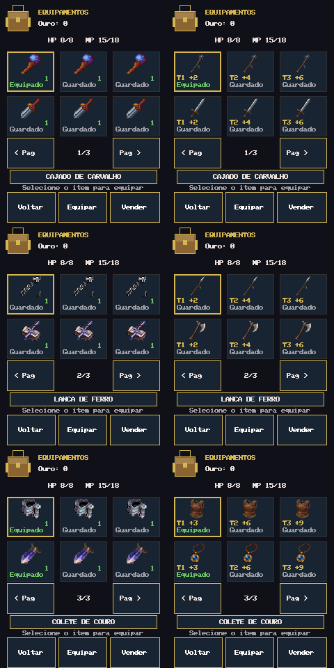
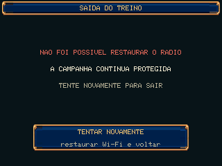
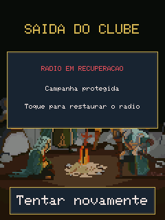

# RPG POKET — auditoria e melhorias locais com Ponytail

Etapa local na branch `audit/ponytail-refresh`, baseada em `aecfabf32edba31fce567a32450503be3492ea66`. A [auditoria](AUDITORIA_PONYTAIL.md) foi escrita antes das alterações de produção; o achado adicional de EOL surgiu na validação Windows e está identificado como tal. Método fixado em [Ponytail 09c434ab](https://github.com/Oflodorporto/ponytail/tree/09c434ab73ca43761c5d8b0c5d341926c2fba710), aplicado por leitura, sem instalação, hooks ou importação de histórico/telemetria.

## O que foi entregue

- **Saída segura do coop:** falhas em unregister/deinit/restauração mantêm a posse exclusiva e a campanha suspensa. A tela oferece **TENTAR NOVAMENTE**; o retry retoma apenas etapas pendentes. A abertura que falha durante rollback usa a mesma tela. Nenhum ACK, sequência, heartbeat, snapshot, regra ou recompensa foi reimplementado.
- **Abertura e saída seguras do PvP:** fila, modo/storage/canal Wi-Fi, desconexão, MAC, ESP-NOW e callback passam a ser conferidos antes de publicar a arena aberta. Uma falha de rollback/fechamento conserva o dono do rádio, suspende o loop da campanha e oferece retry exclusivo. Os dois botões de saída só retornam à Guilda depois da limpeza. Reservas, resultado e protocolo PvP não mudaram.
- **Equipamentos:** os seis PNGs nativos de `equipment01` aparecem na grade, com tier/bônus verdadeiros e estado equipado/guardado. Conversão RGB565 e máscara alpha separada preservam preto opaco. São **13.056 bytes constantes**, sem aumentar `artes.pak` ou PSRAM.
- **Checkout confiável das artes:** `.gitattributes` preserva bytes em assets/cartao. A reconstrução Windows voltou a satisfazer os hashes originais, sem relaxar validação.
- **Documentação atual:** README/estado apontam ao wifitest77 publicado; a qualificação de coopdiag77 está identificada como histórica. Este diff local não herda a qualificação daquela release.

As imagens são capturas do renderer C++ no computador, não fotos da placa ou prova de FPS/RF. Na revisão visual foi encontrado e corrigido um erro de promoção de inteiros do gerador PowerShell que truncava canais RGB; vetores de cores primárias, branco/preto e regeneração exata agora protegem a conversão.

## Testes e evidências

| Verificação | Resultado |
|---|---|
| Suíte de rádio original antes das alterações | 132 checks; duas threads reais para publicação/fence de callbacks; passou |
| Regressão nova sobre produção anterior | Falhou como esperado em `coopIsOpen() && view.page==CoopTraining` após falha de cleanup |
| Regressão corrigida | 94 checks: sete falhas de saída, retry, posse retida, abertura com rollback incompleto, toque antigo, wrap de millis, idempotência e bytes Save30/RNG preservados |
| Reprodução PvP antes/depois | Na base, falha de registro do callback resultou em `open_reported=1`, `arena_opened=1`, callback ausente. Após a correção, `open_reported=0`, `arena_opened=0` |
| Regressão PvP corrigida | 171 checks: dez falhas de abertura, sete de fechamento, rollback incompleto, retry exclusivo, posse retida, Save30/RNG sem mutação |
| Regressões nativas selecionadas, execução final única | **52/52 aprovadas**: saves/reset/NVS, combate/progressão, viagem, economia, sessões longas, toque, coop, 12 suítes PvP, diagnóstico/exportação Wi-Fi, OTA/SD/boot/SPI e compatibilidade UTC do harness Windows |
| Renders antes/depois | **576 + 576 estados**, quatro classes antigas/novas, três slots, 18 equipamentos, bolsa vazia/cheia, páginas/seleções; Game e Save30 inalterados |
| UBSan da lógica nova | Cleanup aprovado em modo trap. Runtime completo de relatórios não está instalado: linker não encontrou `liblibclang_rt.ubsan_standalone*.a` |
| Artes reconstruídas | 666 entradas, payload 7.470.912 bytes, CRC32 `9b4bcfc0`, pacote 7.470.928 bytes, SHA256 `14bb1adc47bb3e4bdde510f80d165bc8622129f0422e2aef908e97b079028c56` |
| EOL | Checkout isolado de três fontes representativas com `core.autocrlf=true` permaneceu idêntico aos blobs Git |
| Limites protegidos | 17 arquivos confirmados inalterados contra a base, incluindo Save/Persistence/NvsPersistence/ResetEpoch/Rules/protocolos/OTA/framebuffer/toque; sem novo reset ou mudança de partição |

Os 52 resultados estão no mesmo `host-validation-final3/results.json`, todos compilados e aprovados. Eles não significam 52 grupos do agregado histórico completo. Tentativas anteriores registram falhas de configuração de compilação; o runner Windows foi corrigido para tratar o exit code, em vez de transformar avisos do compilador em erros de PowerShell. Nenhuma falha foi convertida em aprovação: os adaptadores C++/UTC foram repetidos e os gates históricos abaixo continuam explicitamente pendentes.

**Não concluídos no Windows atual:** diferencial de combate histórico exige GCC com `__builtin_clear_padding`; `dungeon77_upgrade` agora tem sua árvore recovery77 recuperada, mas ainda precisa do runner C++ e headers/biblioteca de desenvolvimento OpenSSL. O agregado Linux de 165 grupos e ASan/LSan completos requerem o ambiente POSIX/GCC/LSan ausente. A validação de instalação/migração OTA sobre bytes reais também depende desses componentes. Os scripts/gates de release existentes não foram enfraquecidos ou substituídos.

Na continuação, `C:\Program Files\Git\bin\bash.exe tools/test_wifitest77.sh` reconstruiu o pacote PKA1, mas parou no primeiro gate de identidade: `fatal: ambiguous argument '4fc221f07b62d6bd26fcf03fa1bb12c8fd577111^{tree}'`, pois o clone local é shallow. Uma tentativa de `git fetch --no-tags origin 4fc221f07b62d6bd26fcf03fa1bb12c8fd577111` falhou em `Could not resolve host: github.com`. Mesmo com aquele ancestral, o gate fixa os hashes/fontes e documentos da release wifitest77 e não qualificaria este novo diff. O teste `package12_coop_config.py` aprovou 12 compilações de flags, mas parou em `assert sketch.count(legacy_marker) == 1`: o novo redraw de recuperação PvP duplicava o marcador textual do extrator histórico. Uma alteração apenas de espaços alinhou o redraw aos demais loops exclusivos; a contagem voltou de 2 para 1, preservando o predicado de campanha. A reexecução do gate pela rota local aprovada com o Zig existente passou: 12 probes compilados de configuração, predicados reais de redraw compilados com coop OFF/ON e 18 probes do wrapper; o extrator congelado permaneceu inequívoco. A falha `error: Unexpected` observada no sandbox era do ambiente de execução, não do teste. `wifitest77_scope.py` exige caminho POSIX; `wifitest77_build_evidence.py` exige symlink que este Windows recusou com `WinError 1314`; `wifitest77_qualification_config.py` não encontrou PyYAML. Nenhuma falha desses gates foi tratada como aprovação do candidato.

**Retomada de 21/10, gates históricos:** no desktop `DESKTOP-R02HL0N`, um único novo fetch de leitura recuperou `4fc221f`, `6026fb`, `ad8acd` e `cf0639` (árvore recovery77 `98a735c86ca856b6250f32675b6d4b0753b9b9b3`). O bloqueio de ancestral shallow caiu. `check_wifitest77_scope.py` passou dessa etapa e recusou este candidato em `Candidate must be sole child of exact docs-main lease`: a branch de auditoria tem alterações locais posteriores à release fixada. `wifitest77_release_verifier.py --synthetic` aprovou 151 probes e então recusou `README.md` por documentação pública congelada distinta. São limites de linhagem intencionais, não regressões funcionais. O teste `wifitest77_build_evidence.py` repetido fora do sandbox continuou bloqueado em `Path.symlink_to` com `WinError 1314`; `wifitest77_scope.py` usa separador POSIX e recusou o caminho Windows como `Noncanonical source path`. Não alterei permissões do Windows nem os gates congelados.

PyYAML 6.0.3 foi instalado isoladamente em `../python-test-deps`, conforme a versão fixada pelo workflow. `wifitest77_qualification_config.py` então ultrapassou os probes de workflow, mas encontrou CRLF do checkout Windows em arquivos históricos comparados por byte. Confirmei que 102 arquivos tinham apenas EOL diferente do blob HEAD/fixado, normalizei-os temporariamente e repeti: o teste avançou até `assert_rules_compatibility`, que exige os dois retornos indexados e o SHA exato de `Rules.h` da qualificação Package12 histórica. O `Rules.h` desta branch não é aquele snapshot. Reconstituí o EOL original desses 102 arquivos e confirmei status sem alterações adicionais. Esse gate não foi aprovado para o candidato atual; a falha não autoriza trocar as regras do jogo para satisfazer uma release antiga.

O desktop não tem WSL, GCC/G++/Clang ou Docker utilizáveis; o Zig local não implementa o builtin GCC requerido nem fornece o runtime completo de LSan. O Git para Windows oferece `libcrypto-3-x64.dll`, mas não `openssl/sha.h` e `libcrypto.a`. Não instalei toolchain ou alterei segurança do host. Testes físicos ficam com Rodolfo e não bloqueiam a conclusão desta etapa de software; alcance RF e atualização na placa permanecem sem comprovação física.

Passaram separadamente os probes sintéticos de rejeição de otimização (43), identidade de release (113), geometria/evidência de convite coop (26) e equivalência do updater. Eles verificam os próprios validadores, não substituem o agregado completo ou ASan/LSan.

## Compilação ESP32

Core instalado **3.3.12**, arduino-cli **1.5.1**, esp-x32 **2601**. Mesma configuração da base: ESP32S3 Dev Module, 240 MHz, QIO, flash 16 MiB, OPI PSRAM, CDC/hwcdc, `app3M_fat9M_16MB`, `EraseFlash=none`.

| Imagem | Bytes reais do .bin | RAM estática informada pela CLI |
|---|---:|---:|
| Base local aecfabf | 3.006.784 | 76.892 |
| Primeira etapa, antes da correção PvP | 3.020.336 | 76.892 |
| Candidato com correção PvP | 3.021.632 | 76.908 |
| Árvore final, após ajuste textual Package12 | 3.021.632 | 76.908 |
| Fallback coop ON / teste rádio OFF | 2.979.808 | 63.060 |
| Fallback coop OFF / teste rádio ON | 2.967.936 | 69.620 |

Base local SHA256: `385342b9aa649496d20c5f1228cf7dc52431329047701dbe3cca0fcd047fdb0f`; primeira etapa SHA256: `aae2bdd5e21db52521e181e322dc08a968f6f2b7b4ff963228068594b2c96c5e`; candidato antes do ajuste textual SHA256: `634eabe4f0c0e03b76a00e1152f3c10277cd46ba4e84673a87c72a3855c7c0e2`; **árvore final SHA256: `c0f091b6b06c23132dcb5b37f2b62c7c412e117891bfee2562dd3c757f2e62c0`**. A imagem final cresceu 14.848 bytes sobre a base e conserva 124.096 bytes livres na partição de 3.145.728 bytes. A CLI informou “Sketch uses 3.021.490 bytes”, distinto do tamanho real do arquivo .bin. Os `partitions.csv` da base e da imagem final são idênticos byte a byte. O Arduino acrescentou somente uma diretiva `#line` à cópia de `EquipmentIcons.h` em `build-after/sketch`; o corpo compilado corresponde byte a byte ao header final. O ELF da primeira etapa aloca 12.288 bytes para pixels e 768 para máscara alpha na região constante. Os hashes dos 168 fontes de produção foram conferidos antes e depois do build da árvore final (`build-source-confirmed.json`), sem alterações. O compilador ESP32 não iniciava dentro do sandbox (`Illegal System DLL Relocation`), mas respondeu normalmente na rota local aprovada, e `arduino-cli` concluiu o build limpo em `build-confirmed-final/`. Os dois binários de 3.021.632 bytes diferem em 69 bytes: hora de compilação embutida e resumos da imagem; o tamanho e a RAM permaneceram iguais. A release pública tem 3.006.736 bytes e SHA diferente; não se afirmou equivalência binária entre o build local e o publicado.

As variantes acima foram compiladas com o mesmo FQBN, core e partição do build final, usando respectivamente `-DRPG_ENABLE_WIFI_RADIO_TEST=0` e `-DRPG_ENABLE_COOP_TRAINING=0`. Seus SHA256 são `6b61b928d6f9d2cbab57c669c2c33ad0ff70774134e68bb6fa4bc629aaab7401` e `826a679bc43d47ee1be5d515b146cc020bd56fd2a15a7be3b3ddac0736129d0d`. Os três `partitions.csv` têm SHA256 `7e9c47a69c32d377ea06ce01c26293aa92b1b244d3e16cce3b5bc4da9e28cbe7`; os 168 hashes de fontes de produção continuam iguais. `../verify_real_bytes.py` validou, num diretório temporário local, o firmware final de 3.021.632 bytes e `artes.pak` de 7.470.928 bytes com seus SHA256, contrato Save30/leitura29/30, 666 assets, limite OTA e estimativa estática de PSRAM. Isso aprova a verificação de identidade/limites sobre bytes reais; não executa o instalador/migrador OTA nem mede PSRAM livre na placa.

## Revisão final segundo Ponytail

Revisados diff, funções chamadas, todos os chamadores de close/active/entrada e o loop exclusivo fora do diff: `CoopRadioDevice`, `CoopRuntime`, `CoopDevice`, `CoopInput`, `CoopViewModel/View`, `RPG_POKET_2.ino`, `RadioOwner`, PvP e diagnóstico Wi-Fi. O retorno à Guilda só ocorre após limpeza confirmada; falha não reativa campanha ou permite outro dono. A fila é invalidada ao abrir a tela de retry, e as ações de sala/combate/INFO ficam bloqueadas nela. A confirmação de saída continua após o drain original de 350 ms.

A grade usa IDs/famílias e bônus já existentes. Regras, preços, inventário, codec de save, formato do pacote e coordenadas dos botões não foram alterados. O gerador verifica hashes, dimensões e alpha originais; o renderer não aloca as imagens em RAM. Não há novo framework ou dependência no firmware.

O achado 2 da auditoria, antes pendente, foi fechado na continuação local. A revisão incluiu os dois chamadores de `closeClub`, a entrada pela Guilda, o branch de recuperação no loop, a tela de toque e a coexistência de donos com coop/diagnóstico. O harness de reboot histórico passou a zerar o estado volátil do driver ao simular novo boot; não há migração de saves. `effects01` permanece reserva artística; não foi acrescentado um novo sistema de efeitos sem uma etapa de orçamento e validação de animação.

**Veredito:** etapa local revisada e demonstrável. Não é uma release qualificada nem comprovação de correção do alcance RF. Sem push, publicação, deploy, instalação ou flash.

## Checklist físico pendente

- [ ] Confirmar os três personagens/saves e pontos da história antes/depois; sem erase NVS ou mudança de partições.
- [ ] Verificar entrada/saída/reentrada do treino com Wi-Fi desligado e conectado; restaurar a rede anterior e testar a tela de retry quando houver falha real do driver.
- [ ] Testar toque, debounce, orientação, gestos mantidos e botões em todas as páginas de equipamentos e no coop.
- [ ] Medir heap/maior bloco/stack e tempo de quadro em sessão longa com artes no SD e atividades LCD/SPI.
- [ ] Ensaiar duas placas como host/convidado, perdas, cancelamento e reconexão; comparar alcance em distâncias/orientações controladas com a base. Nenhuma melhoria RF é presumida.
- [ ] Injetar ou observar erro real de abertura/fechamento PvP e confirmar dono exclusivo, tela de retry e nenhuma cobrança prematura.
- [ ] Validar cores/legibilidade no LCD real, inclusive brilho reduzido e fallback de artes.
- [ ] Somente em tarefa autorizada de instalação: qualificar OTA física e interrupção de energia com cópias verificadas dos saves, após os gates de software e a pendência PvP.

## Reprodução e arquivos de apoio

`tools/prepare_equipment_icons.ps1 -Check` verifica o gerador sem gravar. `tools/test_ponytail.ps1 -Zig <zig.exe> -Out <pasta-de-saida>` executa as suítes Windows selecionadas e registra `results.json` e `not-run.json`; `-Only` permite repetir apenas as suítes afetadas. O teste `tests/ponytail_render.cpp` é compilado como C++17 com asserts ativos; sua opção de baseline utiliza a cópia irmã `repository` desta tarefa. `tools/capture_ponytail.py <pasta-das-capturas>` converte os PPMs em PNG sem dependência externa. `tests/pvp_radio_cleanup.cpp` roda sobre `ClubRadio.h` real com falhas independentes nos fakes; `host-build/pvp-before.log` e `host-build/pvp-after-probe.log` preservam a comparação de comportamento.

No diretório pai do worktree ficam os logs completos, `validation-summary.json`, `protected-source-evidence.json`, `build-source-final.json`, `host-validation*/`, `host-build/`, `render-before/`, `render-after/`, `build-baseline/` e `build-after/`. O protótipo BLE anterior foi preservado com suas alterações locais.

**Comunicação com o pai:** a tentativa de enviar o marco pelo app retornou `thread not found` para o `source_thread_id` recebido. O canal de retorno de delegação não é uma ferramenta de saída disponível neste executor. A entrega final e os arquivos acima são o retorno verificável; nenhuma mensagem foi enviada a outra conversa por aproximação de título.
