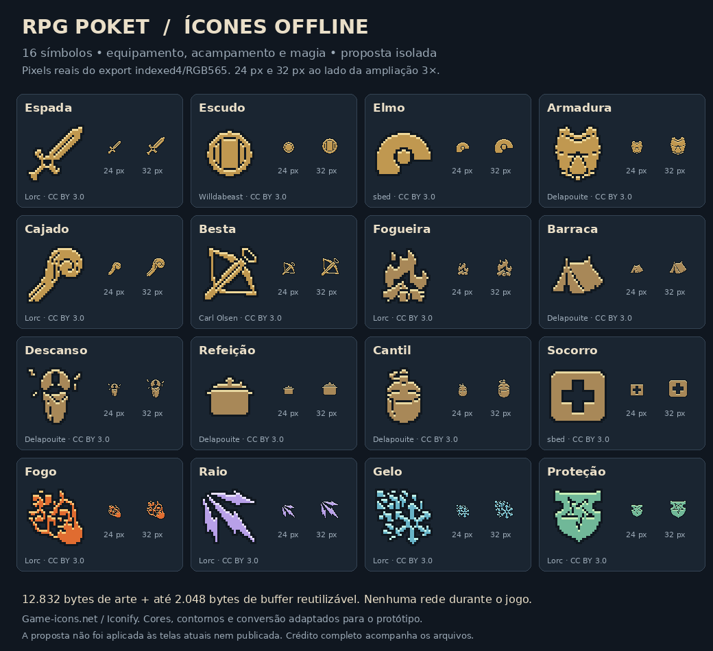

# RPG POKET — proposta local de ícones e referências offline

> Histórico de 16/10/2026. Na candidata visual de 26/10/2026, os ícones de
> espada e escudo de 24 px foram ligados à tela de resultado. O manifesto e o
> build ESP32 da candidata atual substituem a estimativa de incremento zero
> abaixo. Créditos e licença: `assets/public-api-icons1/CREDITS.md`.

## O que já funciona

- 16 ícones reais de equipamento, acampamento e magia, em **24×24 e 32×32**.
- Aquisição da coleção Game Icons pelo snapshot oficial do Iconify, com commits e SHA-256 fixados.
- Crédito individual de **Lorc, Delapouite, sbed, Willdabeast e Carl Olsen**, com página de cada obra e CC BY 3.0.
- Exportação compacta no formato já utilizado pelo projeto: **indexed4, paleta RGB565 little-endian e transparência 0xf81f**.
- Decodificação usando o `Indexed4.h` existente e conversão verificada pelo helper de `prepare_enemy_art.py`.
- Provider C++ opcional com buffer pertencente ao chamador, sem heap, alocação global ou acesso à rede.
- Prévia que mostra os pixels finais, os tamanhos reais e uma ampliação sem suavização.
- Prova editorial separada do Open5e: Light e Mending, exclusivamente SRD 5.2 / `srd-2024`, com CC BY 4.0 e atribuição.

**Estado:** proposta implementada e testada em cópia isolada do código-fonte
`6026fb49db4fe874b9c3f0571cbe4fdb9e66adb3`. Não foi ligada às telas atuais,
gravada em placa, publicada ou enviada ao repositório remoto. Não modifica
arquivos existentes, arte original, índices do catálogo, saves, protocolo
ESP-NOW, efeitos animados, regras de combate ou histórias.

## Prévia



A imagem é uma folha de avaliação do novo pacote, **não uma captura do firmware
atual**. Os ícones pequenos são exibidos a 1×. O formato de 24 px perde detalhes,
principalmente em fogo, gelo e descanso; usar rótulos e preferir 32 px onde couber.
É arte de interface, não substituto para personagens/pets originais nem para
sequências animadas de ataque.

## Arquivos e custos

| Arquivo ou pasta | Papel |
|---|---|
| `assets/public-api-icons1/source-lock.json` | Versões, hashes, autores e licença por ícone |
| `sources/iconify-subset.json` | Somente as 16 geometrias selecionadas |
| `sources/original/` | SVGs upstream preservados, sem alterações |
| `sources/masks/` e `raster-lock.json` | Exportações alpha8 verificadas, produzidas por Inkscape |
| `generated/` | 32 planes indexed4, 32 PNGs dos pixels finais e paleta |
| `CREDITS.md` e `licenses/` | Atribuição individual e aviso original |
| `build-manifest.json` | Geometria, custos, checksums e identidade dos resultados |
| `firmware/RPG_POKET_2/PublicApiIconData.h` | Dados opcionais gerados; não incluídos pelo jogo |
| `firmware/RPG_POKET_2/PublicApiIcons.h` | Provider opcional, decode e desenho por segmentos |
| `assets/srd-reference1/` | Duas referências editoriais; nenhum consumidor no firmware |

São **12.800 bytes de planes + 32 bytes de paleta = 12.832 bytes** de dados
quando as duas resoluções forem usadas. O maior buffer de decodificação ocupa
**2.048 bytes**, reutilizáveis. O código do renderer e eventual alinhamento do
linker são adicionais; não foram medidos em uma compilação ESP32 desta proposta.
O firmware atual não inclui os novos headers, portanto o incremento atual é
zero. O pacote não precisa de cartão SD, download, login ou Wi-Fi em execução.

## Reproduzir sem internet

Python 3.9+ e um compilador C++17 bastam para gerar/verificar o núcleo. Não é
necessário instalar bibliotecas Python para o build ou os testes principais.

```sh
python3 -B tools/fetch_public_api_icons.py
python3 -B tools/prepare_public_api_icons.py --check
bash tools/test_public_api_icons.sh
python3 -B tools/import_open5e_references.py --check
python3 -B tests/open5e_references.py
```

Para exportar em outra pasta, mantendo a árvore de fontes intacta:

```sh
python3 -B tools/prepare_public_api_icons.py --output-root /tmp/rpg-icons-export
```

O algoritmo de redução utiliza cobertura por área com aritmética inteira,
limiar fixo, um pixel de contorno e borda transparente. Não depende da versão
de um redimensionador de imagens. Os bytes gerados são comparados integralmente
no teste de determinismo. As miniaturas PNG são geradas dos pixels RGB565
decodificados, com transparência, pelo próprio exportador.

## Etapas opcionais de produção

Reaquisição explícita dos **mesmos** snapshots fixados:

```sh
python3 -B tools/fetch_public_api_icons.py --fetch
```

Esse comando lê somente os repositórios oficiais fixados no manifesto, recusa
redirecionamentos e respostas grandes, confere todos os hashes e só então
grava os arquivos selecionados. Não salva o catálogo completo ou caches.
Em 16/10/2026, `api.iconify.design` respondeu 403 neste ambiente; a aquisição
real usou o snapshot público oficial no GitHub. A existência dessa alternativa
não garante disponibilidade futura. Falha de rede interrompe a aquisição;
o build offline continua disponível com as fontes já guardadas.

A rasterização SVG inicial é separada do build normal. Usa Inkscape instalado
e Pillow apenas para extrair o canal alpha. Nesta entrega: Inkscape 1.4 e
Pillow 12.3.0. Não instala nem executa scripts baixados.

```sh
python3 -B tools/rasterize_public_api_icons.py --render
python3 -B tools/prepare_public_api_icons.py
python3 -B tools/preview_public_api_icons.py
```

Antes de Inkscape, só são aceitos elementos SVG `path` com `fill=currentColor`
e geometria `d`: scripts, imagens, grupos, URLs, filtros e atributos adicionais
são rejeitados. As máscaras guardadas tornam a fase normal independente do
renderer. Regerar `raster-lock.json` é uma nova revisão de produção; comparar
a prévia e os hashes antes de aceitar mudanças. A folha de contato usa Pillow
e a fonte DejaVu Sans; sua tipografia não faz parte da garantia de pixels do
pacote. Um erro de escrita pode deixar uma exportação parcial, nunca uma
publicação automática.

## Uso C++ em um protótipo de interface

O provider tem IDs próprios, sem reutilizar índices de itens/equipamentos do jogo.

```cpp
#include "PublicApiIcons.h"
uint16_t iconWorkspace[publicApiIcons::MAX_WORKSPACE_PIXELS];
// canvas oferece fillRect(x, y, largura, altura, rgb565).
publicApiIcons::draw(canvas, publicApiIcons::Icon::Campfire, 32,
                     16, 40, iconWorkspace,
                     publicApiIcons::MAX_WORKSPACE_PIXELS);
```

O chamador deve fornecer coordenadas de tela válidas e manter o buffer válido
durante a chamada. `decode` e `draw` retornam false para ID, tamanho, ponteiro
ou capacidade inválidos. Os tamanhos aceitos são somente 24 e 32. Transparência
é ignorada no desenho; não há interpolação nem rede. O buffer pode ser
reutilizado entre desenhos síncronos. A arte é um símbolo, não uma área de toque:
manter as áreas de interação acessíveis do layout existente.

## Plano de integração após revisão visual

1. **Escolher uma tela de teste pequena.** `BagView.h` e `CampView.h` são pontos
   possíveis para símbolos secundários com rótulo. O catálogo de equipamento
   atual em `GearArt.h` tem seis famílias próprias; a seleção deste pacote não
   é um array substituto de `gear_icons` e não cria elmos, escudos ou bestas no
   inventário. Mapear explicitamente apenas símbolos que façam sentido.
2. **Preservar a identidade original.** Fogueira, descanso e cantil podem servir
   a botões/legendas de acampamento. `CampArt.h` e suas animações permanecem a
   fonte visual do cenário. Fogo, raio, gelo e proteção servem a indicadores de
   magia, sem trocar as sequências existentes em `MagicView.h`.
3. **Futuro mapa.** Reutilizar barraca/fogueira/cantil como marcadores legendados
   de descanso/serviços, se esses pontos existirem nas regras futuras. Essa
   proposta não gera mapa, conteúdo procedural, pets ou uma nova mecânica.
4. **Créditos antes da distribuição.** Manter `CREDITS.md`, os links da licença
   e as alterações junto do pacote; ligar um crédito legível na futura tela
   Sobre/Créditos. A licença MIT de uma lista de APIs ou de uma implementação
   não libera as imagens. Este pacote não usa Pokémon ou outra arte dessa franquia.
5. **Qualificar a tela real.** Fazer build ESP32 separado, medir flash, RAM,
   tempo de desenho, legibilidade e toque no aparelho 240×320, revisar regressões
   visuais e depois apresentar a mudança para promoção. Nenhuma dessas provas
   de hardware é alegada nesta entrega local.
6. **Referências de texto.** O Open5e continua editorial e separado. Consultar
   `OPEN5E_REFERENCE_PROPOSAL.md` para a licença, filtragem e limitação de acesso
   HTTP. Qualquer tradução, adaptação de regras ou ligação ao jogo é trabalho
   posterior, sujeito a revisão; o snapshot não altera balanceamento.

## Verificações e limites

- Validação de hashes de origem, originais, máscaras, arte final e créditos.
- Rebuild byte a byte, sem rede; fonte de SVG limitada e URLs pinadas.
- 32 frames no decoder real `Indexed4.h`, buffers protegidos, tamanhos/IDs
  inválidos, transparência e renderer comparado pixel a pixel.
- Compilação C++17 com avisos tratados como erro e UndefinedBehaviorSanitizer.
- Testes de aquisição com HTTP simulado, incluindo falha antes da escrita.
- Testes da prova Open5e, inclusive recusa de documento/licença misturados.
- Revisão visual da folha de contato e revisão independente do código.

Não houve build/gravação ESP32, teste de tela física, publicação, push, alteração
do catálogo PKA1 ou atualização do cartão. A proposta está pronta para avaliação
visual e para uma integração de UI explicitamente delimitada.

## Fontes primárias

- https://icon-sets.iconify.design/game-icons/
- https://github.com/iconify/icon-sets
- https://game-icons.net/about.html
- https://github.com/game-icons/icons
- https://creativecommons.org/licenses/by/3.0/
- Páginas e autores individuais: `assets/public-api-icons1/CREDITS.md`.
